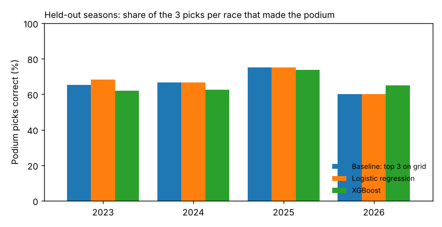
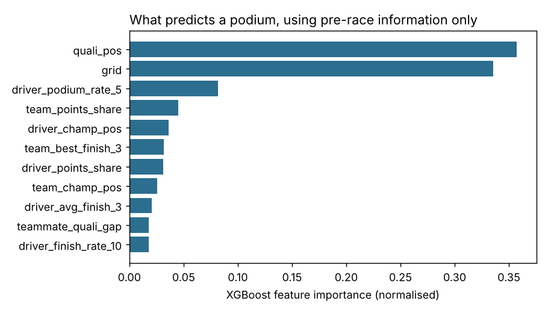

# F1 Podium Prediction

[](https://github.com/mantas123456/f1-podium-prediction/actions/workflows/ci.yml)

Can you predict a Formula 1 podium better than "the front three on the grid", using only
what is known before the race starts? This project trains on 2010–2022, tests on 90
unseen races from 2023 to November 2026, and checks that no feature uses information from
the race being predicted.

## Result: the grid is hard to beat

| Model | Podium picks correct | All 3 correct | ROC-AUC | Log loss |
|---|---:|---:|---:|---:|
| Baseline: top 3 on grid | 67.0% | 23.3% | 0.919 | – |
| Logistic regression | **67.8%** | **25.6%** | 0.937 | 0.216 |
| XGBoost | 65.9% | 18.9% | **0.939** | **0.214** |

*Podium picks correct*: for each race, the three highest-scored drivers are picked, and
this is the share of those picks that finished on the podium.

- **Starting position carries most of the signal.** The models add little when picking
  the top three outright. Over 270 picks, logistic regression gets 183 right and the grid
  baseline 181.
- **The models rank the whole field better** (ROC-AUC 0.94 against 0.92). Their probabilities
  are useful for "who could get a podium from P6", even when they don't change the top three.
- **More complex isn't better here.** XGBoost has the best probabilities but gets the fewest
  top-three picks right (178).



## Why v1 looked better, and what changed

Version 1 reported an F1-score of 0.60 on a random train/test split. It used three inputs that
are not available before a race:

- **Championship standings** from Ergast, which are published *after* each race and
  already include that race's points.
- **Laps completed** and **fastest-lap rank**, which are race outcomes.

Putting those three back into the same model raises podium picks to 73.7% and ROC-AUC to 0.959.
None of that gain would exist in real use. Version 2 removes them, splits by season instead of
at random, and adds a test that scrambles a race's result and checks its features don't change.

## Features (all known before the race)

| Feature | Source |
|---|---|
| `grid`, `quali_pos` | Saturday qualifying and the starting grid |
| `driver_champ_pos`, `driver_points_share` | Standings after the *previous* round |
| `team_champ_pos`, `team_points_share` | Constructor standings after the previous round |
| `driver_avg_finish_3`, `driver_podium_rate_5`, `driver_finish_rate_10` | Driver's previous races |
| `team_best_finish_3` | Team's best finish in each of its previous 3 races |
| `teammate_quali_gap` | Qualifying position relative to the teammate |



## Run it

```bash
git clone https://github.com/mantas123456/f1-podium-prediction
cd f1-podium-prediction
pip install -e ".[dev]"
python -m f1_podium --test-from 2023 --out results
pytest
```

## Data

Ergast-format tables (2010 onward) from
[TracingInsights/RaceData](https://github.com/TracingInsights/RaceData), CC0 licence,
snapshot of 8 November 2026. Only the eight tables used are kept in `data/`.

## Limitations and next steps

- The 2026 season is incomplete (20 of 23 races).
- No weather, tyre strategy or grid penalties.
- The model doesn't know that exactly three drivers finish on the podium. A ranking model,
  or normalising probabilities per race, is the obvious next step.

---
Mantas Valantinavičius · [github.com/mantas123456](https://github.com/mantas123456)
